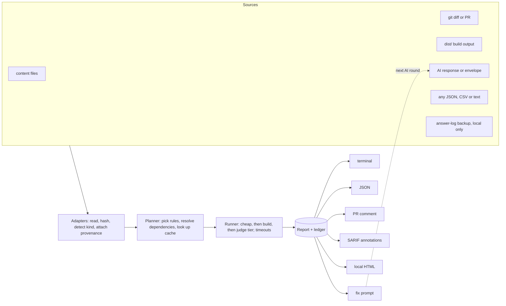

# Audit system: design (draft)

**Status:** draft for review. Nothing here is built yet.
**Scope:** a single program (`npm run audit`) that checks any artifact (a content file, a build output, an AI response, or arbitrary JSON, CSV or text) and records what it finds with as much evidence and context as it can. It works with AI output in both directions: it takes AI responses in and hands findings back in a form an AI can act on. It does not depend on AI. Every built-in rule is deterministic, and AI review is an opt-in extra.

This site is the first host, so the examples use its formats (`mcq/v1`, `supplement/v1`, `outline/v1`) and constraints (see `AGENTS.md`). The core has no site-specific knowledge: formats come in as rule packs.

---

## 1. Why: what exists today

The repo already has good checks, but they are four separate programs with four output formats, and each one throws information away.

| Check today | Where | Covers | What gets lost |
| --- | --- | --- | --- |
| Format validation | `normalizeMcq()` / `normalizeSupplement()` in `scripts/lib/`, called by the build | Schema errors and warnings | The build prints the first 8 messages, then "… and N more" |
| `npm run check` | `scripts/templates/check.mjs` | Format, choice-length bias, citation links, outline index | Terminal text only, no machine-readable output. "Citations not checked" shows up as a note, not a status |
| Submission safety | `submissions/checks.mjs`, `scripts/check-submission.mjs` | PII, scripts, macros, untrusted hosts | Shows 3 examples per finding. Only runs on PRs |
| Student results | `src/assets/answer-log.js` | Which questions students miss | Never fed back to content quality |

Some things nothing tracks at all: **where a file came from** (human, which AI, which prompt), **what changed between versions** (did an AI "fix" round move an answer key?), **history** (is length bias getting better or worse?), and **the built site itself** (relative links, no public links to `api/`, games left out).

## 2. Goals and non-goals

**Goals** (all three required):

1. **Efficient.** Only re-check what changed, and what depends on it. Cheap rules run first. Expensive rules (build-dependent, AI) run only when asked, within a budget, and are cached for good.
2. **Effortless.** One command with no required flags or config. It runs on its own in the build, on PRs, and in the AI authoring loop. Every finding comes with a fix hint, and for AI output, a ready-to-paste fix prompt.
3. **Show as much information as possible.** Every finding carries its evidence, exact location, rule, severity, confidence, provenance and a link to the spec. Nothing gets dropped silently: if a rule was skipped, timed out or was declined, the report says so and why. Displays may shorten lists, but the JSON report keeps all of it.

**Non-goals:**

- It does not replace human review. Merging stays a human decision, as it is today.
- It never executes the content it audits.
- It never sends students' answers anywhere.
- It adds no public page. Reports stay local or in CI.

## 3. Core model

Everything is one of seven record types. They are plain JSON, versioned like the site API, so new fields can be added freely but existing ones are never renamed within a major version.

| Record | What it is |
| --- | --- |
| **Subject** | One thing being audited: `{ id, kind, hash, bytes/text, parsed, provenance }`. `kind` is found automatically from the extension, `schema` field or content: `mcq`, `supplement`, `outline-json`, `outline-docx`, `html`, `pdf`, `ai-response`, `dist-page`, `json`, `csv`, `text`, … |
| **Provenance** | Where it came from: `{ origin: human \| ai \| build \| submission \| import, producer: { name, version, model? }, prompt?: { template, hash }, inputs: [{ name, hash }], createdAt }` |
| **Rule** | One check: `{ id, version, kinds, tier, runtime, needs, docs, run() }` |
| **Finding** | One problem or observation, with evidence (below) |
| **Metric** | A number worth tracking over time (`mcq.key-longest-share = 0.22`, `citations.linked-share = 0.93`) |
| **Coverage** | One row per subject × rule: `ran`, `skipped` (with reason), `timeout`, `error`, `declined`, `cached` |
| **Run** | One invocation: context, git SHA, config hash, timing, and everything above |

### A finding

```json
{
  "rule": "mcq.letter-ref",
  "ruleVersion": 1,
  "severity": "warn",
  "confidence": "high",
  "subject": "content/Torts/Torts_Bar_Exam_Questions.mcq.json",
  "location": { "pointer": "/questions/17/oe/2", "question": "2.3", "line": 412, "column": 9 },
  "message": "The rationale names another choice by letter (\"unlike choice B\"), but this question's choices shuffle.",
  "evidence": { "excerpt": "…, unlike choice B, the plaintiff here…", "expected": "no letter references in a shuffled question", "actual": "choice B" },
  "fix": { "hint": "Name the rule the other choice applies instead of its letter, or set \"fixed\": true if the choices refer to each other." },
  "docs": "docs/mcq-format.md#a-question",
  "provenance": { "origin": "ai", "producer": { "name": "claude", "model": "claude-opus-5-5" }, "prompt": { "template": "ai-prompts#3" } },
  "fingerprint": "mcq.letter-ref:7f3a…",
  "status": "new"
}
```

- **Severity** is one of `block` (fails the gate), `error` (the item is dropped or broken on the site), `warn` (works, but should be fixed) or `info` (an observation). These map onto what exists now: submission `block`/`warn`, and normalizer errors and warnings.
- **Confidence** (`high`, `medium`, `low`) lets heuristic and AI-judged findings appear without drowning out the certain ones.
- **Location** uses a JSON pointer, plus a line and column when the source is text. `JSON.parse` loses positions, so the core includes a small tokenizer that maps each pointer to its offset. It only reads; it never evaluates anything.
- **Fingerprint** is a hash of the rule, subject, pointer and message key, with no line numbers, so it stays stable as a file is edited. It drives the baseline, de-duplication and the `new` / `persisting` / `fixed` / `baselined` status.

### A rule

```js
// audit/rules/mcq.mjs (excerpt)
export const letterRef = {
  id: 'mcq.letter-ref',
  version: 1,
  title: 'Rationale names another choice by letter',
  kinds: ['mcq'],
  tier: 'cheap',          // cheap | build | judge
  runtime: 'web',         // web (no Node APIs) | node
  needs: [],              // e.g. ['refs-index'] for citation rules
  docs: 'docs/mcq-format.md#a-question',
  run({ subject, report }) {
    subject.parsed.questions.forEach((q, i) => {
      if (q.fixed) return;
      q.oe.forEach((text, j) => {
        const m = text.match(/\b(?:choices?|options?|answers?)\s+\(?([A-H])\)?(?![\w])/);
        if (m) report.warn({ pointer: `/questions/${i}/oe/${j}`, question: q.id, message: '…', evidence: { excerpt: around(text, m.index) }, fix: { hint: '…' } });
      });
    });
  },
};
```

Rules are pure functions of their inputs. That makes them cacheable, testable under `node --test`, and safe to run on submission pull requests.

## 4. Pipeline



1. **Adapters** turn every source into Subjects. They compute the content hash (SHA-256 via WebCrypto, so it works on any runtime) and attach provenance.
2. **The planner** matches rules to subject kinds and resolves each rule's `needs` to the hashes of those inputs. For example, a citation rule needs the course's reference index, which depends on the outline and supplement. It then checks the cache and decides what actually has to run.
3. **The runner** runs tiers in order. If a subject won't parse, the rules that need the parsed form are skipped and logged in coverage as `skipped: unparseable`; they don't vanish. Each rule has a timeout (10 s by default). A timeout is recorded as `timeout`, never as a pass.
4. **Reporters** all render from the same JSON report, so they can't disagree.

## 5. Sources

| Adapter | Input | Notes |
| --- | --- | --- |
| `files` | Paths, folders, globs | Default: `content/` |
| `git` | Changes vs. a ref (`--base origin/main`) | Reuses the `check-submission.mjs` diff (`--diff-filter=AM`), then adds dependents |
| `dist` | `dist/` after `npm run build` | Read-only. Never edits `dist/` |
| `ai` | Raw AI text on stdin or from a file, or an `ai-output/v1` envelope | Extraction and provenance, §7 |
| `generic` | Any `.json`, `.ndjson`, `.csv` or `.txt`, with a rule pack or a JSON Schema | What makes it work beyond AI output and beyond this site |
| `answers` | A progress-backup file the owner downloaded from the site footer | Local only, aggregates only, never committed (§7.5) |

## 6. Rule catalog (first version)

Most of these already exist: Phase 0 wraps today's code as rules instead of rewriting it.

| Rule pack | Rules | Tier | Reuses |
| --- | --- | --- | --- |
| **format** | `mcq.schema`, `supplement.schema`, `outline.schema` | cheap | `normalizeMcq`, `normalizeSupplement`, `buildOutlineDocx` |
| **mcq quality** | `mcq.length-bias` (a metric plus a warning past 35% / 60%), `mcq.letter-ref`, `mcq.fixed-missing`, `mcq.choice-count` (five by default), `mcq.rationale-correct-prefix` ("Correct." on the key), `mcq.key-position` (spread of answer letters across fixed questions), `mcq.near-duplicate` (shingle similarity between stems), `mcq.area-coverage` (every outline section the set claims has questions) | cheap | `answerLengthBias`, `LETTER_REF`, `isFixedChoice` |
| **outline format** | `outline.labels` (elements of a multi-part test labeled `(1)…` or `(a)…`), `outline.list-lead-in` (marked `(all required)`, `(any one suffices)` or `(weighed together)`), `outline.case-fields` (court and year, facts, held, why) | cheap | `docs/outline-format.md` |
| **citations** | `citations.links` (every cite, case and problem links), `citations.only-allowed` (cites only sections in the supplement) | build | `lintCitations`, `loadCites` |
| **cross-artifact** | `course.areas-match-outline`, `course.refs-wired` (subject.json `refs` resolve), `course.case-keys` (cases a set names have outline cards) | build | `refIndex` |
| **safety** | `safety.pii`, `safety.scripts`, `safety.macros`, `safety.pdf-actions`, `safety.size` | cheap | `checkFile` in `submissions/checks.mjs` |
| **site** (reads `dist/`) | `site.relative-links`, `site.no-dev-links` (no public links to `api/`, `llms.txt`, the repository or `/admin/`), `site.sitemap` (no `admin`, no `api/specs`), `site.games-excluded` (default build has no game pages or code, but keeps `play/data/`), `site.practice-log` (served copy has it, downloads don't) | build | the rules in `AGENTS.md` |
| **ai** | `ai.extract`, `ai.truncated`, `ai.count`, `ai.placeholder`, `ai.self-talk`, `ai.ungrounded-case` | cheap | new (§7) |
| **compare** | `compare.key-changed`, `compare.id-removed`, `compare.question-dropped`, `compare.area-renamed`, `compare.stem-rewritten` | cheap | new (§7.3) |
| **items** | `items.below-chance`, `items.always-right` | cheap | `answer-log.js` `parseLog` (§7.5) |
| **judge** (opt-in) | `judge.single-best-answer`, `judge.rationale-consistency`, `judge.rule-grounded` | judge | new (§7.4) |
| **generic** | `json.schema`, `csv.columns` (header, types, required, unique), `text.patterns` (deny or require regexes), local custom rules | cheap | new |

## 7. AI integration

AI output connects at three points: **intake** (the AI's response comes in), **feedback** (findings go back to the AI), and **assist** (an AI acting as a reviewer, optional). Only intake and feedback are on by default, and both are deterministic.

### 7.1 Intake: from response to checked file

The easiest path needs nothing extra: pipe the response straight in.

```bash
pbpaste | npm run audit -- --save-as "content/Torts/Torts_Drill.mcq.json" -
```

This does four things in order (all four, or nothing is written):

1. **Extract.** Strip code fences and any prose around the JSON ("Here is the JSON:"), and find exactly one JSON object. `ai.extract` reports what it removed (`info`), or fails if it finds no object or several (`error`).
2. **Detect** the schema and run every rule for that kind.
3. **Write** the file only if there are no `block` or `error` findings. With `--force`, it writes anyway and keeps the findings.
4. **Record provenance** in the file's sidecar, `<file>.meta.json`, under an `audit` key. The build reads only named fields from sidecars, so this key is never published (open question 1).

A richer, optional path is an **`ai-output/v1` envelope**, for tools or agents that can describe what they did:

```json
{
  "schema": "ai-output/v1",
  "producer": { "kind": "ai", "name": "claude", "model": "claude-opus-5-5", "tool": "chat" },
  "prompt": { "template": "ai-prompts#3", "params": { "exams": 2, "perExam": 15, "choices": 5 } },
  "inputs": [{ "name": "Torts_Outline.json", "hash": "sha256:…" }],
  "createdAt": "2026-11-12T15:00:00Z",
  "target": "content/Torts/Torts_Drill.mcq.json",
  "response": "…the raw text, exactly as returned…"
}
```

Each field turns on a stricter check: `prompt.params` lets `ai.count` compare what was asked for (2 exams × 15 questions × 5 choices) with what came back, and `inputs` lets `ai.ungrounded-case` look for each named case in the source material.

| AI rule | Catches | Severity |
| --- | --- | --- |
| `ai.truncated` | JSON cut off at the end, a last question missing fields, a final string that stops mid-sentence | error |
| `ai.count` | Fewer exams, questions or choices than the prompt asked for | error |
| `ai.placeholder` | Template slots left in (`{COURSE}`, `[insert`, `TODO`, `…` as content) | error |
| `ai.self-talk` | Text addressed to the user inside content fields ("As an AI…", "Here is…", "I can't") | warn |
| `ai.ungrounded-case` | A `Party v. Party` name that appears in none of the `inputs` (outside material should be in `[[double brackets]]`) | warn |

### 7.2 Feedback: findings back to the AI

- `npm run audit -- --fix-prompt <file>` prints the "Fixing what the checker reports" prompt from `docs/ai-prompts.md`, already filled in with the JSON and the findings. Each finding is included with its pointer, evidence and fix hint, in a compact form an AI can follow line by line.
- `--format json` is the machine interface. An agent writing content can run the audit on its own draft before handing it back. The same core can also be exposed as a tool (`audit_file(path | text, kind?)` → report, and `explain_rule(id)` → purpose, examples, docs) for agents that call tools. That stays local or in CI, never on the public site.

### 7.3 Compare: checking that a fix round didn't break anything

AI fix rounds are told "don't change which choice is correct", but today nothing verifies that. `npm run audit -- --compare <old> [new]` compares two versions of a set. `old` defaults to the version at `HEAD`, so after an edit, plain `--compare <file>` works.

| Rule | Catches | Why it matters | Severity |
| --- | --- | --- | --- |
| `compare.key-changed` | A question's `a` changed, or its correct text moved to another index | The worst silent error an AI fix can make | block in the AI loop, error otherwise |
| `compare.id-removed` | A question id disappeared or was renumbered | Saved progress, flags and the answer log follow ids | error |
| `compare.question-dropped` | Fewer questions than before | Content lost in the regeneration | warn |
| `compare.area-renamed` | An area name changed | Splits a topic's history in Your stats | warn |
| `compare.stem-rewritten` | A stem's similarity to the old one dropped below a threshold | Substance changed, not just wording | info, with the score |

### 7.4 Assist: optional AI judging

Some quality questions can't be settled by a pattern: *is there exactly one best answer?*, *does the "Correct." rationale agree with the key and the rule line?*, *does the cited section actually say what the rule line claims?* The judge tier asks a model these questions under strict limits:

- **Opt-in only.** It runs with `--judge` and a credential from the environment. It never runs on submission PRs, never runs in default CI, and never receives answer-log data.
- **Advisory only.** Judge findings are at most `warn` with `medium` confidence, and they are labeled `source: judge`. They never block a gate.
- **The auditor gets audited.** Each judge answer must use a fixed schema (`verdict: ok | issue | unsure`, `message`, `evidence_quote`) and must quote the subject. A finding whose quote doesn't appear verbatim in the subject is dropped as unsupported, and that drop is counted in coverage.
- **Grounded.** For `judge.rule-grounded`, the auditor looks up the cited section in the course's reference index itself and passes that text in, so the model judges against the actual statute, not its memory.
- **Efficient.** Results are cached by (subject hash, rule version, model, prompt hash), so an unchanged question is never judged twice. Bulk runs use the Message Batches API (half price, asynchronous). The fixed rubric and supplement text go first in the prompt so prompt caching covers them. `--judge-budget` caps the number of requests, and `--dry-run` counts them before anything is spent.
- **Any provider, or a person.** `judge/provider.mjs` defines `{ name, model, complete({ system, input, schema }) }`. The default adapter uses `@anthropic-ai/sdk` with `claude-opus-5-5`, effort `high`, structured outputs, and handling for `stop_reason: "refusal"` (recorded in coverage as `declined`, never as a pass). A **`human` provider** writes the same rubric questions to a review queue file for a person to answer, so this tier works without AI too.

### 7.5 Item analysis from students' answers (local only)

A question nearly everyone misses may have the wrong key. With `--answers progress-backup.json` (the file the site's footer downloads), the auditor reads the log with `parseLog()` and reports aggregates only:

- `items.below-chance`: at least 5 answers (`MIN_ANSWERS`) and accuracy below chance (20% with five choices). The finding says "check the key", at `info` level by default, and is cross-referenced with `mcq.length-bias`.
- `items.always-right`: right on every one of at least 10 answers. The question may be too easy, or may have a tell.

The backup file stays where the owner put it: it is never committed, uploaded or sent to the judge. One student's history is a small sample, so these findings are signals, not proof, and are labeled that way. The log records right or wrong, not which choice was picked, so analyzing distractors would need one more field (open question 2).

## 8. Efficiency

- **Content-addressed cache** in `.audit/cache/` (gitignored). The key is the subject hash + `rule.id@version` + the hashes of the rule's declared `needs` + the rule's config hash. Running twice on an unchanged tree runs nothing a second time.
- **Dependency-aware invalidation.** Editing `Torts_Outline.json` changes the Torts reference index's hash, which re-runs only the Torts citation and cross-artifact rules. Every other course stays cached.
- **Changed-only by default.** Changes vs. `origin/main`, plus their dependents. `--all` checks everything.
- **Tiers.** `cheap` always runs. `build` runs when `dist/` is current. `judge` runs only on request. A subject that fails to parse skips its deeper rules, and coverage records the skip.
- **Shared expensive steps.** Word-to-HTML conversion (`convertDocx`) is the slowest step. Its output is cached by file hash, so audit, check and build don't each convert the same `.docx`.
- **Concurrency.** A promise pool sized to the CPU count, with per-rule timeouts.
- **Targets** (to verify in Phase 1): cheap tier over all of `content/` in a few seconds on a laptop, and under 30 s added to the PR workflow.

## 9. Effortless use

| Command | What it does |
| --- | --- |
| `npm run audit` | Changed files vs. `origin/main` plus dependents, all non-judge tiers. Short summary in the terminal, full report in `.audit/last.json` |
| `npm run audit -- <paths…>` / `--all` | Specific files or folders, or everything |
| `… -` / `--save-as <path>` | Read from stdin (an AI response or envelope). Write the file only if it passes |
| `--compare <old> [new]` | Version diff (§7.3) |
| `--fix-prompt <file>` | Ready-to-paste prompt for an AI fix round |
| `--format json\|md\|sarif\|html` | Choose the output format. HTML goes to `.audit/report.html`, never `dist/` |
| `--explain <rule>` | The rule's purpose, examples and spec section |
| `--judge [--judge-budget N] [--dry-run]` | Opt-in AI review (§7.4) |
| `--answers <backup.json>` | Local item analysis (§7.5) |
| `--baseline update` | Accept current findings so only new ones fail |

- **Runs without being asked.** The build runs the cheap tier in-process and prints the same short summary it does today, plus where the full report is. The PR workflow runs `audit --context pr` in place of `check-submission.mjs` and keeps the same sticky comment. `npm run check` stays as a command, with the same output, built on the same core.
- **Zero configuration.** Kind, course and reference index are worked out from the path and `subject.json`. `audit.config.json` is optional and only overrides severities, enables or disables rules, and sets thresholds.
- **Baseline, not suppression comments.** Turning on a new rule shouldn't flood anyone with old findings. `audit/baseline.json` records accepted fingerprints, each with a `reason` and an optional `until` date. Baselined findings still appear in every report (counted and listed as `baselined`), so nothing is hidden. Content files can't contain suppressions, and PR runs read the baseline from the base branch, so a submission can't silence its own findings.

## 10. Showing as much information as possible

- **One canonical report** (`audit-report/v1`), with every reporter rendered from it:

  ```json
  {
    "schema": "audit-report/v1",
    "run": { "id": "…", "context": "local", "git": "83ada10", "config": "sha256:…", "durationMs": 1840 },
    "summary": { "subjects": 41, "findings": { "block": 0, "error": 2, "warn": 37, "info": 12 }, "new": 3, "fixed": 1, "baselined": 30, "cached": 118, "skipped": 4 },
    "subjects": [{ "id": "…", "kind": "mcq", "hash": "sha256:…", "provenance": { "origin": "ai" } }],
    "coverage": [{ "subject": "…", "rule": "citations.links", "status": "skipped", "reason": "no reference index: run npm run build" }],
    "metrics": [{ "subject": "…", "name": "mcq.key-longest-share", "value": 0.22, "expected": 0.2 }],
    "findings": []
  }
  ```

- **Coverage is part of the result.** "0 findings" and "not checked" are never confused. Every subject × rule pair has a status, and the summary counts skipped, timed-out and declined pairs.
- **Displays shorten, the report doesn't.** The terminal and PR comment list the most severe findings first and say how many more there are and where the full list is. The PR comment puts complete lists in collapsible `<details>` blocks.
- **Inline on the diff.** SARIF output, uploaded in the PR workflow, puts findings as annotations on the exact lines (using the pointer-to-line mapping). This is free for public repositories.
- **History.** `.audit/ledger.ndjson` appends one summary and the metrics for each run. That answers questions like: is length bias in the Evidence sets improving, which findings were fixed this week, and which prompt template or model produces the most `ai.truncated` findings. The last one is only possible because provenance is recorded.
- **Explanations.** Every rule has a title, a rationale, an example that passes and one that fails, and a link to the spec section. `--explain` and the HTML report show them.

## 11. Gates by context

| Context | Runs | Fails on |
| --- | --- | --- |
| `build` | cheap tier, all of `content/` | nothing (prints a summary, like today) |
| `pr` (submissions) | safety, format and quality on changed files | `block` |
| `local` (default) | cheap and build tiers, changed files plus dependents | `error` or worse that isn't baselined |
| `ai` (`--save-as`, `--compare`) | everything for that file, plus `ai.*` and `compare.*` | `error` or worse, and any `compare.key-changed` |

## 12. Constraints carried over from `AGENTS.md`

1. **Never execute content.** Data is read with `JSON.parse` and text scans. HTML is scanned as text. Word files are read with `fflate` and `mammoth`, as today. The HTML report escapes everything it shows.
2. **The core is web-standard** (no Node APIs), like `submissions/core.mjs`, so the same rules can run in the submissions worker. Node-only rules (`docx`, `git`, `fs`) declare `runtime: 'node'`.
3. **`dist/` is read-only** to the auditor. Reports go to `.audit/`, never into the published site, the sitemap or any public link.
4. **Answers stay in the browser** unless the owner downloads a backup and points the auditor at it. Even then the auditor reports aggregates only and sends nothing anywhere.
5. **Submissions only add files.** No rule ever asks a submitter to edit a shared file. Provenance goes in the submission's own sidecar.
6. **No secrets in the repo.** The judge's credential comes from the environment and is used locally only.
7. **Versioned schemas.** `audit-report/v1` and `ai-output/v1` follow the API rule: add fields freely, and bump the major version to rename or remove one.
8. **Games stay behind `ctx.games`.** `site.games-excluded` checks the default build, and is skipped for `--games` builds.

## 13. Proposed layout

```
audit/
  core.mjs            records, planner, runner, fingerprints, policy, JSON-pointer positions (web-standard)
  node.mjs            CLI: fs and git adapters, cache, worker pool, ledger
  rules/              format, mcq, outline, citations, course, safety, site, ai, compare, items, generic
  adapters/           files, git, dist, ai (extraction and envelope), generic, answers
  reporters/          terminal, json, markdown, sarif, fix-prompt, html
  judge/              provider.mjs, claude.mjs, human.mjs (opt-in)
  baseline.json       accepted findings (owner-maintained)
audit.config.json     optional overrides
.audit/               gitignored: cache, last.json, ledger.ndjson, report.html
tests/audit.test.mjs  plus tests/fixtures/audit/
```

`package.json` gets `"audit": "node audit/node.mjs"`. `scripts/templates/check.mjs` and `scripts/check-submission.mjs` become thin wrappers around it.

## 14. Rollout

| Phase | Delivers | Done when |
| --- | --- | --- |
| **0. Core and wrappers** (no behavior change) | Records, runner, JSON reporter. Today's checks wrapped as rules. `npm run audit` | `npm run check` output is byte-identical (golden test), and the JSON lists the same findings |
| **1. Runs everywhere** | Build summary, PR workflow on audit (same comment, plus SARIF), cache, baseline | A second run on an unchanged tree is 100% cached. The PR comment has full lists |
| **2. AI loop** | Extraction, envelope, `--save-as` with provenance, `ai.*`, `compare.*`, `--fix-prompt`. `docs/ai-prompts.md` updated to use them | A truncated response fails with its cause. A fix round that moves a key is blocked |
| **3. Breadth** | Outline-format, cross-artifact and site rules. Ledger and trends. HTML report. Item analysis | Every rule in §6 except the judge tier ships with fixtures |
| **4. Judge** (optional) | Provider interface, Claude and human providers, budgets, quote verification | A dry run reports cost first. Unsupported quotes are dropped and counted |

## 15. Testing

- `tests/audit.test.mjs` runs under `node --test`. Each rule has a fixture that passes and one that fails, in `tests/fixtures/audit/`.
- A golden test confirms `npm run check` output is unchanged after Phase 0.
- A cache test: edit a Torts outline fixture, and only Torts citation rules re-run.
- Security tests: a set whose stem holds `<script>` is never executed and comes out escaped in the HTML and Markdown reports. A PR that adds a baseline entry doesn't change the PR's own result.
- A schema test: every reporter's output comes from a report that validates against `audit-report/v1`.

## 16. Open questions for the owner

1. **Provenance in public?** Should the model and prompt template show in the public API (`catalog.json`), or stay internal? The draft keeps it internal.
2. **Record the chosen choice in the answer log?** Adding it as a 7th element of each entry is backward-compatible, since `parseLog` accepts 6 or more, and it would allow distractor analysis. It also stores more about each student's answers, though still only in their own browser.
3. **Judge budget and model.** Is a monthly cap acceptable, and is the default model right? Should it ever run in a scheduled workflow, or only on demand?
4. **Stricter rules for AI output?** Should `warn` findings block when `origin: ai` (in `--save-as`), but not for hand-written files?
5. **Keep history in git?** Commit the ledger, or keep it local plus CI artifacts?
